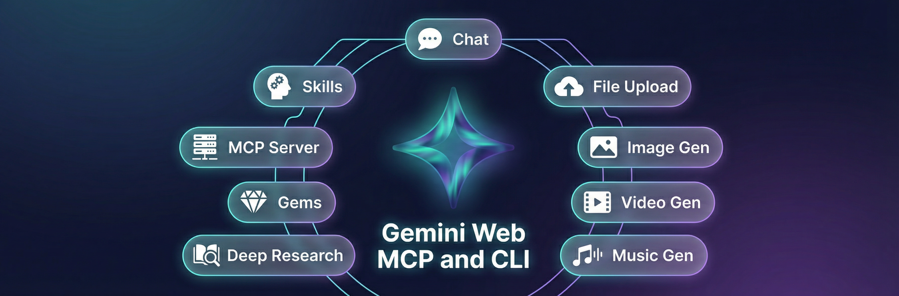

<p align="center">
  
</p>

# gemini-web-mcp-cli

MCP server and CLI for the [Gemini web interface](https://gemini.google.com). Reverse-engineers the Gemini web UI's RPC protocol to provide programmatic access to all Gemini features.

## Features

- **Chat** with model selection (Gemini 3.7 Flash, Flash Extended, 3.1 Pro, and more)
- **File upload** for context in conversations (images, PDFs, documents, audio)
- **Interactive REPL** with slash commands, session persistence, and model switching
- **Image generation** via Nano Banana Pro / Nano Banana 2 with explicit aspect ratios (1:1, 9:16, 3:4, 4:3, 16:9)
- **Video generation** via Gemini Omni with orientation (landscape/portrait), model tiers, and templates
- **Music generation** via Lyria 3.5 with Length/Vocals/Genre controls, 24 templates, and 16 legacy style presets
- **Deep Research** with multi-source reports
- **Usage limits** checking with account/profile, per-feature usage %, credits left, and reset time — plus profile flipping when quota runs out
- **Gems** management (custom system prompts)
- **Multi-profile** support with cross-product profile sharing (NotebookLM MCP)
- **MCP server** with 10 consolidated tools for AI agent integration
- **Skill system** to teach AI tools (Claude Code, Cursor, Codex, etc.) how to use gemcli
- **Hack Claude** — launch Claude Code powered by Gemini (`gemcli hack claude`)
- **API server** — local Anthropic-compatible API backed by Gemini
- **Diagnostics** (`gemcli doctor`) for installation, auth, and configuration checks
- **One-command setup** (`gemcli setup add <tool>`) for MCP client configuration

## Vibe Coding Alert

Full transparency: this project was built by a non-developer using AI coding assistants. If you're an experienced Python developer, you might look at this codebase and wince. That's okay.

The goal here was to learn — both about building CLI tools in Python and about how modern web applications work under the hood. The code works, but it's very much a learning project, not a polished product.

**If you know better, teach us.** PRs, issues, and architectural advice are all welcome. This is open source specifically because human expertise is irreplaceable.

> **Educational & Research Use:** This project reverse-engineers the Gemini web interface protocol for educational and research purposes. It is **not affiliated with, endorsed by, or sponsored by Google**. Use of this tool is at your own risk, and you are responsible for compliance with Google's [Terms of Service](https://policies.google.com/terms). The authors assume no liability for how this software is used.

## Installation

```bash
# With uv (recommended)
uv tool install gemini-web-mcp-cli

# With pip
pip install gemini-web-mcp-cli

# With pipx
pipx install gemini-web-mcp-cli

# Development
git clone https://github.com/jacob-bd/gemini-web-mcp-cli
cd gemini-web-mcp-cli
uv pip install -e ".[dev]"
```

### Upgrading

```bash
# With uv
uv cache clean && uv tool install --force gemini-web-mcp-cli

# With pip
pip install --no-cache-dir --upgrade gemini-web-mcp-cli

# With pipx
pipx upgrade gemini-web-mcp-cli
```

## Quick Start

### 1. Authenticate

```bash
gemcli login                  # Automated Chrome login via CDP
gemcli login --manual         # Paste cookies manually
gemcli login --check          # Validate current session
gemcli login --check --all    # Health of every profile (exit 3 if any needs sign-in)
```

Automated login opens Chrome, navigates to gemini.google.com, and captures cookies via CDP. If you have a NotebookLM MCP profile, gemcli can reuse it automatically.

### 2. Chat

```bash
gemcli chat "What is the meaning of life?"
gemcli chat "Explain quantum computing" -m pro
gemcli chat "Summarize this" -o summary.md
gemcli chat                   # Interactive REPL
```

**Interactive REPL commands:**

| Command | Description |
|---------|-------------|
| `/model <name>` | Switch model (pro, flash, gemini-3.8-flash, gemini-4-argon, thinking) |
| `/thinking on\|off\|low\|medium\|high` | Set thinking level (`on` = high) |
| `/task on\|off` | Send later messages as a Task or a Chat |
| `/verify` | Show server model hash |
| `/new` | Start new conversation |
| `/save <file>` | Export conversation |
| `/history` | View conversation turns |
| `/help` | Show help |
| `/quit` | Exit REPL |

### 3. Generate Images

```bash
gemcli image "A red panda wearing a top hat in a bamboo forest"
gemcli image "A futuristic city at sunset" -o city.png
```

### 4. Generate Videos (Gemini Omni)

```bash
gemcli video "Ocean waves crashing on a rocky beach at sunset"
gemcli video "Dancing robot" -o robot.mp4
gemcli video "A vertical story for Shorts" -O portrait -o story.mp4
gemcli video "A cinematic oner" -m pro -O landscape -o shot.mp4
gemcli video -T "Logo reveal" "NAIDA'S hair salon" -o logo.mp4
```

### 5. Generate Music (Lyria 3.5)

```bash
gemcli music "A comical R&B slow jam about a sock"
gemcli music "Cats playing video games" -s 8-bit -o track.mp3
gemcli music "Summer vibes" -s k-pop -o video.mp4 -f video
gemcli music "A chill study beat" -g lo-fi -L short
gemcli music "An upbeat ad jingle" -V vocals -g pop -T "Brand jingle" -o jingle.mp3
gemcli music --list-styles                # Show all 16 legacy style presets
```

**Available style presets:** 90s-rap, latin-pop, folk-ballad, 8-bit, workout, reggaeton, rnb-romance, kawaii-metal, cinematic, emo, afropop, forest-bath, k-pop, birthday-roast, folk-a-cappella, bad-music. Also accepts aliases like "rap", "metal", "ambient", "chiptune".

### 6. Deep Research

```bash
gemcli research "Latest advances in quantum computing 2026"
gemcli research "AI regulation landscape" -o report.md
```

### 7. File Upload (Chat with Attachments)

```bash
gemcli chat "Summarize this document" -f report.pdf
gemcli chat "What's in this image?" -f screenshot.png
gemcli chat "Compare these" -f file1.md -f file2.md
gemcli file upload document.pdf     # Upload only, get identifier
```

Supported file types: images (PNG, JPEG, GIF, WebP), PDFs, documents, audio files. Files are uploaded via Google's resumable upload protocol and attached to the chat message automatically.

### 8. Hack Claude (Use Gemini in Claude Code)

```bash
gemcli hack claude                    # Launch Claude Code with Gemini Flash
gemcli hack claude --model gemini-pro # Use Gemini Pro
gemcli hack claude -p "fix this bug" # Pass args through to Claude Code
```

Automatically starts a local Anthropic-compatible API server backed by Gemini, configures Claude Code to use it, and cleans up when done. Requires `claude` CLI to be installed.

### 9. Manage Gems

```bash
gemcli gems list
gemcli gems create --name "Code Reviewer" --prompt "You are an expert code reviewer..."
gemcli gems delete <gem-id>
```

### 10. Check Usage Limits

```bash
gemcli limits                    # Account/profile + per-feature usage % and credits left
gemcli -p work limits            # Check another account before flipping
```

Requires Chrome for browser cookie authentication. Output starts with the
account and profile, then per-feature usage: the server-reported usage
percentage, credits left in the plan pool (size depends on the plan), and the reset
time Google reports for each row. The live web view is
`https://gemini.google.com/usage`. When a media tool is disabled because its
usage is exhausted, retry with another profile (`gemcli -p <profile> video ...`).

## Profile Management

```bash
gemcli profile list                    # List profiles
gemcli profile create work             # Create new profile
gemcli profile switch work             # Switch active profile
gemcli -p work limits                  # Check another account's quota
gemcli -p work video "..." -o clip.mp4 # Run any command as that profile
gemcli chat "hello" --profile work     # Use specific profile
```

Cross-product profile sharing: gemcli automatically discovers profiles from NotebookLM MCP (`~/.notebooklm-mcp-cli/profiles/`). No copying — profiles are read live.

Environment variable: `GEMCLI_PROFILE=work` overrides the active profile.

## MCP Server Setup

Use `gemcli setup` to configure the MCP server for your AI tools in one command:

```bash
gemcli setup add cursor            # Configure Cursor
gemcli setup add claude-code       # Configure Claude Code
gemcli setup add claude-desktop    # Configure Claude Desktop
gemcli setup add gemini-cli        # Configure Gemini CLI
gemcli setup add windsurf          # Configure Windsurf
gemcli setup add cline             # Configure Cline
gemcli setup add antigravity       # Configure Antigravity
gemcli setup list                  # Show configuration status
gemcli setup remove cursor         # Remove configuration
```

Or add manually to your MCP client config:

```json
{
  "mcpServers": {
    "gemini-web-mcp": {
      "command": "gemini-web-mcp",
      "args": []
    }
  }
}
```

### Available MCP Tools

| Tool | Actions | Description |
|------|---------|-------------|
| `chat` | send | Conversations with model selection, extensions, and file attachments |
| `image` | generate, download | Image creation (Nano Banana Pro / 2) with aspect ratios |
| `video` | generate, status, download | Video creation (Gemini Omni) with orientation, model, templates |
| `music` | generate, list_styles, download | Music generation (Lyria 3.5) with length, vocals, genre, templates |
| `research` | start, status | Deep Research with reports |
| `gems` | list, create, update, delete | Custom Gem management |
| `canvas` | create, update, export | Canvas documents (coming soon) |
| `code` | execute, download | Python sandbox (coming soon) |
| `file` | upload | File uploads for conversation context |
| `limits` | (none) | Check per-feature usage quotas, remaining count, and reset time |

## Skill System

Skills teach AI tools how to use gemcli effectively. Install a skill so your AI assistant knows all gemcli commands, workflows, and best practices.

```bash
gemcli skill install claude-code   # Install for Claude Code
gemcli skill install cursor        # Install for Cursor
gemcli skill install codex         # Install for Codex (AGENTS.md format)
gemcli skill install gemini-cli    # Install for Gemini CLI
gemcli skill list                  # Show installation status
gemcli skill update                # Update all installed skills
gemcli skill show                  # Display skill documentation
gemcli skill uninstall claude-code # Remove a skill
```

**Supported tools:** claude-code, cursor, codex, opencode, gemini-cli, antigravity, cline, openclaw, alef-agent, other (exports all formats).

## Persistent Chrome (for background processes)

Image generation, video generation, music generation, and Pro/Thinking models require Chrome for BotGuard token generation. If running from a background process (macOS LaunchAgent, cron, systemd), Chrome cannot be launched on demand. Start it once from an interactive terminal:

```bash
gemcli chrome start              # Start headless Chrome daemon
gemcli chrome start --visible    # Start with visible window
gemcli chrome status             # Check health, port, auth status
gemcli chrome stop               # Stop the daemon (waits for running jobs; --now doesn't)
```

The daemon runs headless, survives terminal close, and is automatically detected by Token Factory. `gemcli chrome status` verifies both the Google auth cookie and Gemini's live `SNlM0e` page token; the daemon is used only for the profile it holds (`-p <other>` uses that profile's own Chrome), and saved cookies are never injected into it. After a reboot, run `gemcli chrome start` again.

**Which features need Chrome?**

| Feature | Chrome needed? |
|---------|---------------|
| Chat (Flash) | Used when available (falls back to direct HTTP without it) |
| Chat (Pro / Argon / thinking / Task) | Yes |
| Chat with file attachments | Yes (BotGuard required) |
| Image generation | Yes (BotGuard + tool activation required) |
| Video generation | Yes (BotGuard + tool activation required) |
| Music generation | Yes (BotGuard required even on Flash) |
| Deep Research | No |

## Keeping Sessions Alive (multiple profiles, unattended use)

Google sessions stay alive while the browser that owns them keeps using them;
profiles you don't touch for a few days go stale. The keep-alive renews every
logged-in profile through **its own** Chrome and saves the fresh cookies — it
never copies a Chrome profile or injects cookies, which is what gets sessions
revoked.

```bash
gemcli login --check --all                            # Which profiles are signed in (read-only)
gemcli keepalive run                                  # Renew every profile now
gemcli keepalive run --recover                        # ...and try one-click re-sign-in if one expired
gemcli keepalive status                               # Last result per profile + schedule
gemcli keepalive install-agent --every 4 --recover    # macOS LaunchAgent: run every 4 hours
gemcli keepalive uninstall-agent
```

The Chrome daemon's profile is refreshed from the daemon itself. `--recover`
only clicks Google's account chooser for the matching account and never types
anything; a password, passkey, or "verify it's you" page means you need to run
`gemcli login --profile <name>`, and the run exits with code `3` naming the
profile. Every run is logged to `~/.gemini-web-mcp-cli/logs/keepalive.jsonl`.

Each signed-in profile also gets a **token-capture probe** (aborted inside
Chrome, so nothing is sent to Gemini). `keepalive status` shows
`token capture ok/failed`: a profile can be signed in while the BotGuard path
that uploads and media need is broken; `keepalive run` exits `1` then.

**Exit codes** (all commands): `0` success, `1` failure, `3` authentication
needed — so scripts can do `gemcli music "..." || notify-me`.

Never schedule `gemcli login` (cron/LaunchAgent/pipeline): it stops the
profile's Chrome daemon and opens a sign-in window nobody sees.

## Heavy / Parallel Use

Every request passes through the profile's Chrome for a BotGuard token, and
that Chrome has one Gemini tab. gemcli takes a per-profile lock for that step,
so parallel CLI runs and MCP calls queue instead of overwriting each other's
prompt and token (before 0.8.3 this showed up as a false "Session expired").

- Jobs on one profile take turns for the token step (a few seconds each); the
  generation itself runs in parallel. Spread big batches across profiles with `-p`.
- A job waits up to `GEMCLI_PROFILE_LOCK_TIMEOUT` seconds (default 300), then
  fails with "Profile '…' is busy".
- `gemcli chrome stop`, `gemcli login` and the keep-alive wait for running
  jobs; the daemon's 12h/1.5 GB restart only happens while it is idle.
- Replies that say the attachment couldn't be opened fail with "Gemini did not
  read the attachment" instead of returning an invented answer
  (`GEMCLI_ATTACHMENT_CHECK=0` to disable).
- Use a dedicated Chromium build to isolate gemcli from other Chrome tools:
  `gemcli config set browser "/path/to/Chrome for Testing"`.

Troubleshooting for agents and scripts:
[`references/troubleshooting.md`](src/gemini_web_mcp_cli/data/references/troubleshooting.md).

Background: [docs/research/auth/session-lifecycle.md](docs/research/auth/session-lifecycle.md).

## Diagnostics

```bash
gemcli doctor              # Check installation, saved auth, and configuration
gemcli doctor --verbose    # Detailed diagnostics with paths and timestamps
gemcli -p work doctor --deep   # Also test the live path (token capture + tiny upload)
```

The doctor command checks:
- Installation (gemcli and gemini-web-mcp binaries)
- Chrome (binary detection, saved profiles, persistent daemon status)
- Configuration (config directory, profiles, NotebookLM cross-product)
- Authentication (saved cookies and tokens for the profile)
- With `--deep`: BotGuard token capture in the profile's Chrome and a tiny
  upload — the path uploads, images, video, music and Pro depend on. Sends
  nothing to Gemini chat; exits 1 on failure.
- MCP clients (configuration status across all supported tools)
- Skills (installation status)

## Verb-First Aliases

Alternative command syntax for convenience:

```bash
gemcli list gems               # = gemcli gems list
gemcli list profiles           # = gemcli profile list
gemcli list skills             # = gemcli skill list
gemcli create gem --name ...   # = gemcli gems create --name ...
gemcli delete gem <id>         # = gemcli gems delete <id>
gemcli install skill <tool>    # = gemcli skill install <tool>
gemcli update skill [tool]     # = gemcli skill update [tool]
```

## AI-Friendly Documentation

```bash
gemcli --ai                    # Print full AI-friendly docs to stdout
```

Outputs complete documentation in a format optimized for AI assistants to read and understand the full CLI and MCP tool surface.

## Architecture

```
src/gemini_web_mcp_cli/
    core/              # RPC transport, auth, parsing (shared foundation)
    services/          # Business logic (single source of truth)
    data/              # Skill documentation (ships with package)
    cli.py             # CLI (Click) — thin wrapper over services
    mcp.py             # MCP server (FastMCP) — thin wrapper over services
    setup.py           # MCP client configuration helper
    skill.py           # Skill installer for AI tools
```

All interfaces (CLI, MCP, future API) consume the same service layer. When Gemini changes an RPC, you update one service file and everything works.

## Development

```bash
git clone https://github.com/jacob-bd/gemini-web-mcp-cli
cd gemini-web-mcp-cli
uv venv && source .venv/bin/activate
uv pip install -e ".[dev]"
pytest tests/ -v                  # 568 tests
ruff check src/ tests/            # Lint
```

## Acknowledgments

Protocol knowledge informed by [HanaokaYuzu/Gemini-API](https://github.com/HanaokaYuzu/Gemini-API), an excellent reverse-engineering of the Gemini web interface. Clean-room rebuild following patterns from [notebooklm-mcp-cli](https://github.com/jacob-bd/notebooklm-mcp-cli) and [perplexity-web-mcp](https://github.com/jacob-bd/perplexity-web-mcp).

## License

MIT
